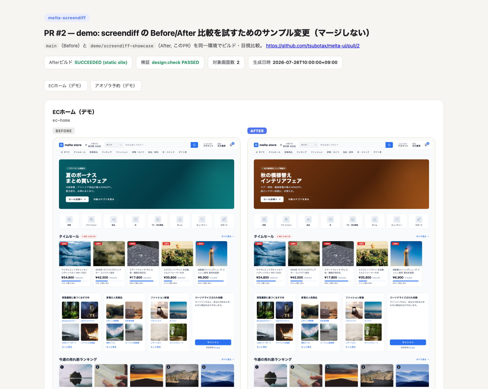

# melta-screendiff

UI変更PRを **Before/After の実キャプチャ** でレビューするための Claude Code plugin。

PR番号を渡すと、PRのbaseブランチ（Before）とPRブランチ（After）をそれぞれ checkout → ビルド → 対象画面をキャプチャし、横並びの比較HTMLを生成する。レビュアーは手元でビルドせずに視覚差分を判断できる。

- **web backend**: dev server起動 + Playwrightフルページ撮影（Chrome フォールバックあり）
- **ios backend**: シミュレータービルド + deep link起動 + ページング撮影（スクロール全域カバー）+ VoiceOver重複読み上げ検査
- 比較HTMLの生成は画像をAIのコンテキストに通さない（PNGを直接base64でHTMLに埋め込み。AIが画像をReadするのは差分コメントを書くための目視のみで、埋め込み枚数はトークンを消費しない）
- PRコメント投稿は下書き提示 → 人間承認のHITL（勝手に投稿しない）

## 生成される比較HTML



実例: [melta-ui #2](https://github.com/tsubotax/melta-ui/pull/2)（2画面を変更したデモPR）。ビルド結果・検証状況・対象画面数をヘッダに出し、画面ごとに Before/After を横並びで表示する。対象画面が複数ある場合は上部の目次リンクから各画面へ飛べる。

## インストール

```
/plugin marketplace add tsubotax/melta-screendiff
/plugin install screendiff@melta
```

## まず試す（自分のリポジトリに設定を書く前に）

[melta-ui](https://github.com/tsubotax/melta-ui) に設定ファイル（`.claude/screendiff.json`）とデモPRを用意してある。**静的HTMLを `python3 -m http.server` で配信するだけなので、npm install も build も不要**:

```bash
git clone https://github.com/tsubotax/melta-ui.git
cd melta-ui
```

Claude Code をこのディレクトリで開いて:

```
/screendiff:screendiff 2
```

[PR #2](https://github.com/tsubotax/melta-ui/pull/2) は常設のデモPR（マージしない）。上のスクリーンショットと同じものが手元で生成される。

## 前提条件

| 必須 | 用途 |
|---|---|
| gh CLI（認証済み） | PR diff/view/checkout/comment |
| Python 3 | scripts/ 実行（標準ライブラリのみ） |
| 対象リポジトリの設定ファイル | 下記「設定」参照 |

backend別:

| backend | 必須 | 任意（あると価値が上がる） |
|---|---|---|
| web | dev serverが1コマンドで立つこと | Playwright（無ければヘッドレスChromeでファーストビューのみ） |
| ios | 任意の画面をdeep linkで開けること・シミュレータービルドが1コマンドで通ること | [sim-use](https://github.com/lycorp-jp/sim-use) CLI（無ければ1ページ目のみ撮影） |

**iOSでdeep link基盤が無い場合は移植不可。まずUIカタログ（画面ID→View登録簿）+ URLスキームハンドラを作ること。**

## 設定

探索順（先に見つかったものを採用）:

1. `<repo>/.claude/screendiff.json` — チームとして導入するリポジトリ
2. `~/.config/melta-screendiff/<repo名>.json` — **対象リポジトリに1ファイルもコミットできない場合**（客先リポ等）のユーザー側設定

サンプルは [examples/](examples/)、全フィールドの説明は [docs/contracts.md](docs/contracts.md) を参照。最小構成（web）:

```json
{
  "backend": "web",
  "target_file_patterns": ["^src/(pages|components)/"],
  "web": { "serve_command": "npm run dev", "serve_url": "http://localhost:5173" },
  "screens": {
    "route_map": [
      { "file_pattern": "^src/pages/index\\.", "id": "home", "path": "/", "title": "ホーム" }
    ]
  }
}
```

### ⚠️ serve_command に dev server を指定するときの罠

**SPAフォールバックを持つサーバーを指定すると、存在しないパスでも 200 が返る。** 撮影対象がズレていてもエラーにならず、Before/After が同じ画面になって「差分なし」と誤結論する。

Vite は `appType` の既定値が `"spa"` で、**MPA としてビルドしていても dev / preview サーバーは未知のHTMLパスをルートの `index.html` に書き換えて 200 を返す**（`htmlFallbackMiddleware`）。Next.js 等も同様のフォールバックを持つ。

安全側に倒すなら、**ビルド成果物を素の静的サーバーで配信する**（存在しないパスが 404 になり、capture が中断する）:

```json
"web": {
  "serve_command": "npm run build && python3 -m http.server 5180 --directory dist",
  "serve_url": "http://localhost:5180"
}
```

`setup_command` と `serve_command` に分けず `&&` で繋ぐのが重要。分けるとビルド失敗時に**前のブランチの `dist/` を配信して別refを撮る**事故になる。

### ⚠️ モノレポで「前のブランチの成果物」が混入する罠

依存パッケージのビルド成果物が **gitignore されている**場合、`git checkout` してもファイルは消えない。そこで「成果物が無ければビルドする」型のセットアップスクリプト（`if (existsSync(artifact)) continue;`）を通ると、**After 側でビルドした成果物を Before 側のビルドがそのまま使う**。Before に After のコードが混入し、差分が小さく見える。

npm workspaces のモノレポでこれを踏みかけた。回避するには、**依存 workspace のビルドを serve_command で明示的に走らせる**:

```json
"serve_command": "npm run build --workspace=packages/tokens && npm run build --workspace=packages/ui && npm run build --workspace=apps/preview && python3 -m http.server 5180 --directory apps/preview/dist"
```

**PRが依存パッケージのソースを変更しうるなら（`target_file_patterns` に含めているなら）、その依存のビルドを毎回強制する。** 存在チェックによるスキップに任せない。

### ⚠️ ビルド成果物が作業ツリーに残る（`cleanup_command`）

Before/After を撮り終えて元のブランチに戻っても、**gitignore されたビルド成果物は消えない**。最後に撮った Before 側の成果物が残り、「成果物が無ければビルドする」型のセットアップスクリプトを持つリポジトリでは、次の通常作業がその古い成果物を掴む。

任意の `cleanup_command` を設定すると、元refへの復帰と `git stash pop` が**成功した後にのみ**リポジトリルートで1回実行される:

```json
"cleanup_command": "npm run clean --if-present"
```

失敗したら握り潰さず、比較結果の共有フェーズへ進む前に `git status` / `git stash list` を提示して止まる。

**広域削除を書かないこと。** `git clean -fdx` のようなコマンドは、直前の `git stash pop` で復元した untracked ファイルや、比較HTMLを置いた `output_dir` まで消す。消す対象はパスで限定する。

### 比較結果をPRに書き込まない（`share_mode: "local"`）

既定（`"artifact"`）では比較HTMLを Artifact として発行し、PR本文への追記やコメント投稿まで進む。閲覧者が Artifact の共有経路にアクセスできない場合や、比較画像を外部の共有面に置くべきでない案件では `local` を使う:

```json
"share_mode": "local"
```

`local` では **comparison.html をローカルに生成して絶対パスを提示するところで完了**する。Artifact の発行も、`gh pr comment` / `gh pr edit` によるPRへの書き込みも一切行わない。生成されたHTMLをどこへ配るか（チャットに添付する、ブラウザで開いて画面共有する、社内ドライブに置く）は人間が手で決める — 配布のHITLをAI側に持ち込まない設計にしてある。

実行時に上書きもできる:

```
/screendiff:screendiff 42 --share local
```

どのアクションを許すかは `share_plan.py` が確定させる（モード × author/reviewer × Artifact可否）。`local` ではPRへの書き込みが `forbidden` に入り、分岐の読み違いで投稿が走らないようにしてある。

### route_map の必須項目

web backend では `route_map` の各エントリに **`path`（"/" 始まり）が必須**。省略すると撮影URLが `serve_url` そのもの（＝トップページ）になり、「変更された画面」としてトップを撮ったまま気づけないため、設定読み込み時にエラーで落とす。認証が必要な画面はログイン画面にリダイレクトされた時点で中断する（現状、認証状態を持ち込む仕組みは未対応）。

変更ファイル→画面の解決が `route_map`（宣言的マッピング）で足りないリポジトリは、`screens.resolver_command` に自前の逆引きコマンドを指定できる（出力のJSON契約は docs/contracts.md §2）。

## 使い方

```
/screendiff:screendiff 42        # PR #42 をレビュー（plugin名:スキル名の名前空間付き）
```

処理フロー: 適用範囲判定 → base先行チェック → Before/After 各々 checkout・ビルド・撮影 → 比較HTML生成 → Cleanup（作業ツリー復帰）→ 共有（Artifact提示 → PRコメント下書き、承認後のみ投稿）。PR作者が自分のPRに比較Artifactを添付する **authorモード** もある（SKILL.md参照）。

**Cleanup は共有より先に走る。** 作業ツリーの復帰に失敗した状態でPRへ書き込むと、取り消せない外向きの操作だけが進んで手元の破損が放置されるため。

### base が進んでいると撮影前に止まる（`before_base`）

OPEN PR の Before をどこから撮るかで、比較に映るものが変わる。

| `before_base` | Before | 何が見えるか | base が先行していたら |
|---|---|---|---|
| `"branch_tip"`（既定） | base ブランチ先端 | 今の base にこのPRを載せた姿 | **中断**（PRが加えていない差分が混ざるため） |
| `"merge_base"` | PR の分岐点 | このPRだけで何が変わったか | **続行**（比較はPR固有の差分のまま） |

既定では撮影前に `git merge-base --is-ancestor` で検査し、base が PR の分岐後に進んでいれば「PRブランチに base を取り込んでから再実行」を案内して中断する（撮ってから補正はできないため）。

**base が日常的に進むリポジトリではこのゲートがほぼ毎回発火する**（他チームの日次リリース、リリース自動コミット等）。その場合は `merge_base` を選ぶ:

```json
"before_base": "merge_base"
```

`merge_base` は成功偽装ではない — PR固有の差分としては正しい比較になる。ただし「今の base に載せたらどう見えるか」は分からないので、比較HTMLのヘッダに `Before基準: merge-base（PRの分岐点）` を出して黙って基準を変えないようにしてある。実際に撮った2コミットのOIDも manifest.json と比較HTMLに残る。

### 出力は実行ごとに分かれる

`output_dir/<PR番号>/<実行時刻>/` に出力し、`output_dir/<PR番号>/latest` が最新実行を指す。同一PRの撮り直し（レビュー指摘 → 修正 push → 再撮影）で前イテレーションの証跡が消えず、中断した回に前回の比較HTMLを掴むこともない。過去の実行ディレクトリは自動削除しない。

### 範囲モード（PR を使わない Before/After）

PR を出さず main へ直接 push する一人開発や、push 前に見た目だけ確かめたい場面向けの**別の入口**。PR モードのゲート（HEAD 一致・base 先行チェック）は一切緩めず、`screendiff_range.py` が 2 点（または作業ツリー）を**隔離 snapshot** からビルドして比較する。作業ツリーで checkout も stash もしない。

```
/screendiff:screendiff --range origin/main..HEAD        # 未 push の commit 群
/screendiff:screendiff --range HEAD --after worktree     # 未 commit を After に（明示実行のみ）
```

結果の `run_status` は 5 値で、**どの値でも通常の push を止めない**:

| run_status | 意味 |
|---|---|
| `compared` | 比較 HTML ができた |
| `no_ui_change` | 対象ファイルの変更が無い（何もビルドしない） |
| `skipped_dependency_change` | package / lock / patches が Before・After・共有元で一致せず撮らない |
| `skipped_runner_unavailable` | ブラウザを起動できない環境（sandbox 内など）。通常の Terminal から再実行 |
| `failed` | ビルド・配信・描画の失敗 |

事故対策（設計レビュー 3 周で固定）:

- **依存の 3 者一致**: snapshot の `node_modules` は作業ツリーへの symlink なので、Before・After・作業ツリーの依存ファイルのハッシュが揃わないと撮らない（揃わないと両側が別の依存でビルドされる）
- **nonce で配信元を確認**: side ごとの export 先に実行固有の nonce を置き、URL 経由で同じ中身が返るまで ready にしない。固定ポートなら起動前に応答があれば中断する（前回の残存サーバを撮らない）
- **撮った同じブラウザで検査**: `location.pathname` と画面固有の `ready_selector` を要求し、成立しない画面は「比較不能」にする（SPA フォールバックや JS 遷移で同じ画面を 2 回撮って「差分なし」と誤結論しない）
- **作業ツリー比較は内容ハッシュを前後で突き合わせ**、撮影中に変わったら HTML に大きく出す。push 対象の commit と対応しないので commit 比較の代用にしない
- **画面の分類は機械に任せる**: expo-router なら `screens.resolver: "expo_router"` がファイルパスから「直接撮る / 代表画面 / 未対応」を決める。手書きの route_map は子画面を親画面に解決する誤りをレビュー 3 周連続で残した（docs/contracts.md §2.1）
- **ref は開始時に OID へ固定**し、ビルド中の commit / fetch で After がズレない。撮れる画面が 0 の UI 変更は `failed` で未対応一覧を出す（「変更なし」にしない）。実装レビュー 1 周目の 5 件（docs/contracts.md §1.5「runner の不変条件」）

保証しないこと: snapshot の `node_modules` は作業ツリーへの書き込み可能な symlink なので、ビルドが `node_modules/.cache` 等へ書くことは止めない。守るのは「作業ツリーの追跡ファイルと `.git` に触らない」まで。

設定は `range` 節に書く（サンプル: `examples/screendiff.range-expo.json`、契約: docs/contracts.md §1.5）。Codex からは `codex/screendiff/SKILL.md` を手順書として読む。

## 設計の背景

このスキルの手順の多くは実運用で起きた事故への対策としてルール化されている（stale binary/stale server対策、マージ済みPRのcheckout戦略、撮影失敗の成功偽装禁止、Cleanupの必須実行など）。詳細は [SKILL.md](skills/screendiff/SKILL.md) と [docs/contracts.md](docs/contracts.md) を参照。**冗長に見えても削らないこと。**

## Related

- **[melta UI](https://github.com/tsubotax/melta-ui)** — 人間にもAIにも読めるデザインシステム。DS違反を lint / CI / hook で機械的に検知する。screendiff は「機械が検知できない、見た目の意図」を人間がレビューする側を担当する。screendiff 自体は melta UI に依存しない。

## License

MIT
